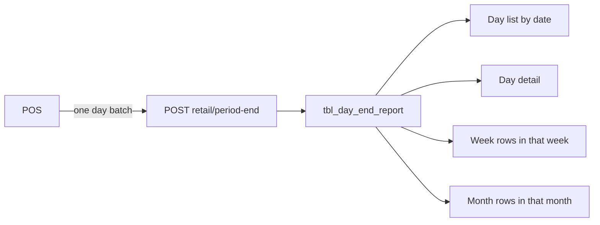

# Combined period-end report table

Day End, Week End, and Month End show the same sections. POS sends one finished Day End row per batch. Week End and Month End do not have their own rows. They select the Day End rows whose `start_date_time` and `end_date_time` fall in the chosen week or month.

Leave [`POST /api/pos/reporting/retail/batch`](src/app/api/pos/reporting/retail/batch/route.ts) and `tbl_batch` as they are. Checkout still depends on the existing retail tables. This report uses a new route.

## One table

`tbl_day_end_report` in [`database/reporting/retail/001-tables.sql`](database/reporting/retail/001-tables.sql), for newly provisioned retail stores only. Existing store schemas stay manual, the same way as `tbl_shift_end_report`.

- `id` bigserial primary key. Detail URL for a day-end batch.
- `batchid` bigint not null unique. POS batch id. A later sync of the same batch updates this row. This is the same role as `shiftid` on the shift report.
- `batch_number` integer not null. Day End list `#`.
- `start_date_time` timestamptz(6) not null. Batch start. Day, week, and month filters all use this column.
- `end_date_time` timestamptz(6) null. Batch end. Null while the batch is open.
- `status` varchar(10) not null, check `Open` or `Close`.
- `employeename` varchar(100) null. Header on all three reports.
- `department_sales` jsonb not null default `'{"rows":[],"total":null}'`. Department table plus its Total row.
- `sales_summary` jsonb not null default `'[]'`. Net Sales Amount, Tax Paid, Gross Sales Amount, No of Transaction.
- `cash_status` jsonb not null default `'[]'`.
- `sales_breakdown` jsonb not null default `'[]'`.
- `paid_out` jsonb not null default `'{"rows":[],"total":""}'`.
- `paid_in` jsonb not null default `'{"rows":[],"total":""}'`.
- `tax_detail` jsonb not null default `'{"rows":[],"total":null}'`.
- `cash_acceptor` jsonb not null default `'[]'`.
- `employee_status` jsonb not null default `'[]'`.
- `miscellaneous` jsonb not null default `'[]'`.
- `promotion_summary` jsonb not null default `'[]'`.
- `created_at` timestamptz(6) default `now()`.

Index on `(start_date_time, end_date_time)`.

Table sections are JSON arrays of row objects so a store can send more departments, taxes, terminals, or employees without new columns. Card sections are ordered `{ "label", "value" }` arrays, the same pattern as shift sales. A Total row stays inside that array (`name` or `terminal` equal to `Total`). Department sales and tax detail keep the Total object beside `rows` because the screen prints it as a footer.

`department_sales` row: `trans`, `name`, `quantity`, `discountAmount`, `discountPercent`, `subTotal`, `tax`, `total`, `share`.

`tax_detail` row: `name`, `quantity`, `rate`, `taxable`, `tax`, `share`.

`cash_acceptor` row: `name`, `openingRecycler`, `closingRecycler`, `openingCashbox`, `closingCashbox`.

`employee_status` row: `name`, `clockIn`, `clockOut`, `total`.

`miscellaneous` row: `terminal`, `noSale`, `voidCount`, `voidAmount`, `returnCount`, `returnDeposit`, `returnTax`, `returnAmount`.

`promotion_summary` row: `name`, `count`, `quantity`, `beforeSale`, `discount`, `afterSale`.

`paid_out` and `paid_in`: `rows` is a label/value list, `total` is the amount the card shows. An empty list still shows the total.

## POS body

`POST /api/pos/reporting/retail/period-end`. Same HMAC auth and `201 accepted` / `200 duplicate` result as the shift route. Upsert by `batchid`.

Each body is one Day End batch: `batchid`, `batch_number`, `start_date_time`, `end_date_time`, `status`, `employeename`, then the JSON sections. `Close` requires `end_date_time`. There is no week or month body.

Add [`docs/postman/store-reporting-retail-period-end.postman_data.json`](docs/postman/store-reporting-retail-period-end.postman_data.json) with day-end batch rows whose dates can be searched as a day, a week, and a month.

## How each screen reads

Date overlap uses the store timezone, same rule as Shift End: `start_date_time` is on or before the filter end, and `end_date_time` is on or after the filter start. An open batch with no end stays in range when its start is on or before the filter end.

- Day End list uses the date the user picks. The eye opens `/report/day-end-report/{id}` and prints every section for that one batch.
- Week End uses the selected week's first and last day as that same overlap. Every matching batch is printed, oldest `start_date_time` first, with the same sections as the day detail. The title is the week range.
- Month End uses the selected month's first and last day the same way. The title is that month.

The page prints each stored batch as POS sent it. It does not add department or tax rows from several batches into one new total. Restaurant day, week, and month screens stay on their current views.

No database session runs from this work. You add `tbl_day_end_report` on the current store, then post the day-end sample rows.
