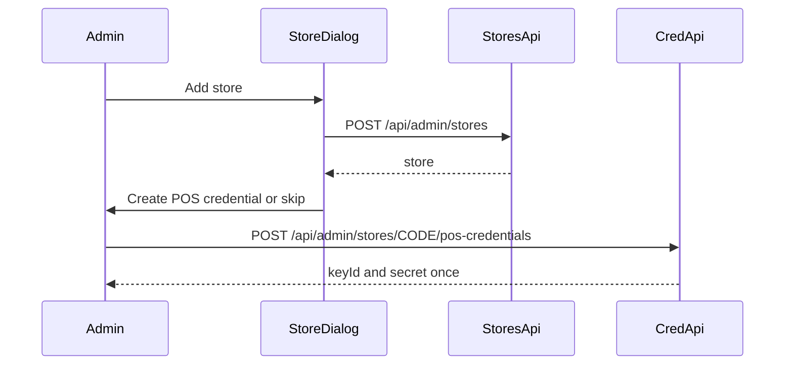

# POS credential after store create

Today, [store-management.tsx](<src/app/(dashboard)/admin/stores/store-management.tsx>) closes the add-store dialog as soon as `POST /api/admin/stores` succeeds. POS credentials are issued only by [scripts/pos-credential.mjs](scripts/pos-credential.mjs) (`npm run pos:credential -- create STORE_CODE`). The plaintext secret is printed once and stored encrypted in `pos_credentials`.

## Flow

After a successful create, keep the dialog open and switch it to a POS credential step for that store. **Skip** closes without issuing a credential. **Create POS credential** calls the new admin endpoint and then shows store code, key ID, and Base64 secret with copy actions and a warning that the secret will not be shown again.

Add the same **POS credential** action on each store row so an admin can issue one later. Creating another credential does not deactivate the previous one, matching the CLI. Deactivate stays on `npm run pos:credential -- deactivate`.

## API

Add `POST` and `GET` at [src/app/api/admin/stores/[storeCode]/pos-credentials/route.ts](src/app/api/admin/stores/[storeCode]/pos-credentials/route.ts), guarded by `getAdminAuthorization()` like the other admin store routes.

- `POST` with an empty body. Store must exist and be active (same check as the script). Returns `201` `{ storeCode, keyId, secret }`. `404` if missing, `409` if inactive, `503` if `POS_CREDENTIAL_ENCRYPTION_KEY` is missing or not a Base64 32-byte key.
- `GET` returns `{ credentials: [{ keyId, active, createdAt }] }` with no secrets, so the dialog can list keys already issued.

Implement creation in a server module (for example [src/lib/pos-credentials.ts](src/lib/pos-credentials.ts)) using `withDb` and the same AES-256-GCM insert as the script: `keyId` `pos-` plus 12 hex chars, 32-byte secret, IV, ciphertext plus auth tag. Do not log the secret. Leave the CLI script in place.

## UI

In [store-management.tsx](<src/app/(dashboard)/admin/stores/store-management.tsx>), after create success, open the credential step instead of closing. The row action opens the same dialog. Show existing key IDs from `GET`, then the one-time secret only after `POST`.

## Docs

Add the two routes to [docs/ai-handover/API_DOCUMENTATION.md](docs/ai-handover/API_DOCUMENTATION.md) and note the admin UI path beside the CLI in [docs/pos-notification-api.md](docs/pos-notification-api.md) and [docs/ai-handover/ENV_SETUP.md](docs/ai-handover/ENV_SETUP.md). No schema or contract change to existing store endpoints.
