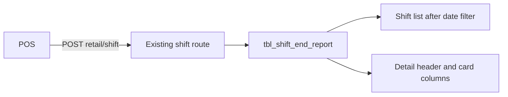

# Shift End report table

First report only: Shift End. Other retail reports stay as they are. Existing POS mirror tables such as [`tbl_shift`](database/reporting/retail/001-tables.sql) stay in place; this does not replace them and does not sync checkout or payment rows for this screen.

The retail Shift End list and detail currently read sample rows in [`retail-shift-data.ts`](<src/app/(dashboard)/report/shift-report/_components/retail-shift-data.ts>). One new table, `tbl_shift_end_report`, holds both. There is no `tbl_shift_details`.

## One table

Store code is not a column. The registered per-store schema already isolates the row. Times use `timestamptz(6)`, the same type as the other retail reporting tables, so the date filter can use the store timezone.

`id` is the local report key and the detail URL. `shiftid` is the POS shift id. A later sync of the same shift updates that row.

Two list columns sit beside the proposed fields because the current table shows them: `batch_number` is Batch#, and `status` is Open or Close.

- `id` bigserial primary key.
- `shiftid` bigint not null unique. POS identity for upsert.
- `stationname` varchar(100). List “Terminal” and detail “Station”.
- `batch_number` bigint not null. List “Batch#”.
- `shift` int not null. List “Shift#” and detail “Shift”.
- `start_time` timestamptz(6) not null. List “Start Date/Time” and the date filter.
- `end_time` timestamptz(6) null. List “End Date/Time”. Null while the shift is open.
- `status` varchar(10) not null check `Open` or `Close`.
- `employeename` varchar(100). Detail “Employee Name”.
- `employeeid` int. Detail “Employee ID”.
- `totaltime` varchar(20). Detail “Total Time”, sent by POS, for example `06:07:28`.
- `sale` jsonb not null default `'[]'`. Sales card.
- `taxes` jsonb not null default `'[]'`. Taxes card.
- `sale_breakdown` jsonb not null default `'[]'`. Sales Breakdown card.
- `terminalcashstatus` jsonb not null default `'[]'`. Terminal Cash Status card.
- `miscellaneous` jsonb not null default `'[]'`. Miscellaneous card.
- `terminalcashtransfer` jsonb not null default `'[]'`. Terminal Cash Transfer card.
- `created_at` timestamptz(6) default `now()`.

Index on `(start_time, end_time)` for the date overlap search.

Date filter, in the store timezone: a shift matches when its start date is on or before the filter end, and its end date is on or after the filter start. An open shift with no end stays in range when its start is on or before the filter end. Labels such as `Jul-16-2025 07:15:39 PM` are formatted in the UI from the timestamps.

## JSON in each card column

Each card column is an ordered JSON array. Beer, wine, spirits, and gift card are more objects inside `sale`. Totals stay in that same array. The default is `[]`. An empty object would not keep the line order PostgreSQL `jsonb` stores.

POS sends the lines. The dashboard does not add them up from transactions. Money stays exact decimal strings. Bold and divider styling stays in the UI for the labels it already knows (Net Sales Amount, Total, Difference, and the others in the sample). Unknown labels render as normal lines.

`sale`:

```json
[
  { "label": "Beer", "value": "520.00" },
  { "label": "Wine", "value": "140.00" },
  { "label": "Spirits", "value": "86.00" },
  { "label": "GiftCard", "value": "0.00" },
  { "label": "Net Sales Amount", "value": "746.00" },
  { "label": "Discount", "value": "80.00" },
  { "label": "Tax Paid", "value": "46.80" },
  { "label": "Gross Sales Amount", "value": "792.80" },
  { "label": "Total Transactions", "value": "6" }
]
```

`taxes`, `sale_breakdown`, `terminalcashstatus`, `miscellaneous`, and `terminalcashtransfer` use the same `{ "label", "value" }` array. The detail page reads one column per card and prints every line. Terminal Cash Transfer is a new card from `terminalcashtransfer`; the current sample screen does not have that section yet.



## Existing shift API

Keep [`POST /api/pos/reporting/retail/shift`](src/app/api/pos/reporting/retail/shift/route.ts). Same HMAC auth, `request_id`, and `201 accepted` / `200 duplicate` result with `shiftid`. The `shift` object stops mirroring `tbl_shift` and becomes one report row. [`parseRetailShift`](src/lib/reporting/retail-snapshot.ts) and [`syncRetailShift`](src/lib/reporting/retail-sync.ts) validate and upsert `tbl_shift_end_report` by `shiftid`. This route no longer inserts into `tbl_shift` and no longer requires a `tbl_batch` parent.

Checkout sync still reads `tbl_shift` before accepting an order, so a store that only sends this new shift body will get `409 Create the shift before this transaction.` on [`/api/pos/reporting/retail/orders`](src/app/api/pos/reporting/retail/orders/route.ts). That order route stays unchanged in this step.

Replace [`docs/postman/store-reporting-retail-shift.postman_data.json`](docs/postman/store-reporting-retail-shift.postman_data.json) with the report body. Also replace the matching ten-row sample in [`docs/postman/retail-10/shift.json`](docs/postman/retail-10/shift.json), because that collection posts the old `tbl_shift` columns. Update the shift example in [`docs/ai-handover/API_DOCUMENTATION.md`](docs/ai-handover/API_DOCUMENTATION.md).

```json
{
  "request_id": "example-retail-shift-1",
  "shift": {
    "shiftid": "201",
    "stationname": "REG1",
    "batch_number": "5",
    "shift": "2",
    "start_time": "2026-10-27T04:05:00Z",
    "end_time": "2026-10-27T10:12:28Z",
    "status": "Close",
    "employeename": "Ada",
    "employeeid": "4",
    "totaltime": "06:07:28",
    "sale": [{ "label": "Beer", "value": "520.00" }],
    "taxes": [{ "label": "Total", "value": "46.80" }],
    "sale_breakdown": [{ "label": "Cash", "value": "351.85" }],
    "terminalcashstatus": [{ "label": "Opening Balance", "value": "23.23" }],
    "miscellaneous": [{ "label": "No Sale Hit Count", "value": "0" }],
    "terminalcashtransfer": []
  }
}
```

`shiftid`, `batch_number`, `shift`, and `employeeid` are positive integers, sent as strings or numbers, matching the other retail POS ids. `end_time` may be null while `status` is `Open`. Each card value is an array of `{ "label", "value" }` strings. Money stays an exact decimal string.

## Order of work

1. Table and API. Add `CREATE TABLE` to [`database/reporting/retail/001-tables.sql`](database/reporting/retail/001-tables.sql) so a newly provisioned retail store gets `tbl_shift_end_report`. Change `POST /api/pos/reporting/retail/shift` to upsert one row by `shiftid`. Replace the shift Postman samples and the API doc example with the report body. Update the handover notes for the table and the shift route.
2. Show live rows. After that API exists, the retail Shift End list and detail read `tbl_shift_end_report` through the signed-in store’s registered schema. The date filter and the detail cards use those rows. Restaurant Shift End stays on its current sample view.

No database session runs from this work. Existing store schemas are not altered here. You add `tbl_shift_end_report` on those schemas yourself, then post sample rows with Postman to `POST /api/pos/reporting/retail/shift`. The list and detail show whatever those calls stored.

No other report tables in this step.
