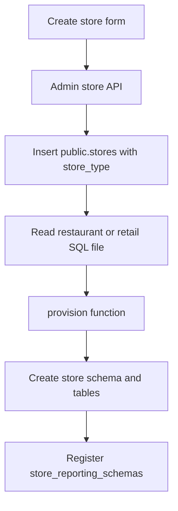

# Store type, file-based schemas, and type-specific dashboards

Existing stores stay restaurant. Store type is chosen only when the store is created and is not editable later, because the schema is already built.

Retail `CREATE TABLE` SQL is the next paste. It is not in the repo, so no retail columns will be invented. When a store is created as Retail POS, that paste is what gets executed: create the store schema, then create every table in the pasted list inside that schema. The retail report-to-table map is still separate and is required only for live retail report pages.

## What changes at store create

Create-store form in [`src/app/(dashboard)/admin/stores/store-management.tsx`](<src/app/(dashboard)/admin/stores/store-management.tsx>) gains a required type: Restaurant POS or Retail POS, next to name, code, and timezone. The list shows the type. Edit stays name, timezone, and active only.

[`parseStoreInput`](src/lib/store-admin-validation.ts) accepts `storeType: "RESTAURANT" | "RETAIL"`. [`createStoreWithReporting`](src/lib/reporting/store-creation.ts) inserts it on `public.stores` and provisions the matching schema in the same transaction.

Public metadata only, in [`prisma/schema.prisma`](prisma/schema.prisma):

- enum `StoreType { RESTAURANT RETAIL }`
- `Store.storeType` mapped to `store_type`, default `RESTAURANT`

A new SQL migration adds that column and backfills existing rows to `RESTAURANT`. This is the schema change this work needs. Reporting tables stay out of Prisma.

Per-store tables cannot be Prisma models. Each store gets its own schema name (`store_` + sanitized code), and Prisma can map a model to only one schema. Putting `tbl_rpt_*` in `schema.prisma` would make `prisma migrate` try to create one fixed schema and collide with the known integer-ID vs UUID migration drift. Column lists stay in the SQL file. Restaurant API fields stay in [`src/lib/reporting/columns.json`](src/lib/reporting/columns.json), which must be updated in the same change whenever a restaurant column is added.

## File-based schema create

Today the real `CREATE TABLE` text is copied inside `public.provision_store_reporting` in [`prisma/migrations/20261014000000_reporting_batch_shift/migration.sql`](prisma/migrations/20261014000000_reporting_batch_shift/migration.sql). [`database/reporting/001-tables.sql`](database/reporting/001-tables.sql) is only a template.

New layout:

- [`database/reporting/restaurant/001-tables.sql`](database/reporting/001-tables.sql) — current restaurant tables, still using `__SCHEMA__` and `__STORE_CODE__`
- `database/reporting/retail/001-tables.sql` — the pasted retail `CREATE TABLE` list, same `__SCHEMA__` and `__STORE_CODE__` placeholders, different tables from restaurant. Retail store create runs this file and no other table list.
- `database/reporting/<type>/upgrades/NNN-description.sql` — later column adds for stores that already exist

Store create reads the server file for the chosen type. The client never sends SQL. A new migration replaces the provision function so it still owns schema naming, `CREATE SCHEMA`, placeholder substitution with `quote_ident` / `quote_literal`, the restaurant-only legacy customer copy, and the `store_reporting_schemas` insert. The function executes the DDL string the app read from the file. It stays `REVOKE`d from `PUBLIC`. No HTTP route accepts DDL.

Adding a column later is two edits, not a rewrite of the function:

- Update `001-tables.sql` so new stores are created with the column.
- Add the next upgrade file with `ALTER TABLE` so existing schemas of that type gain the column, then bump `reporting_version` only for schemas that ran it.

Restaurant POS sync (`/api/pos/reporting/orders`, batch, shift) runs only when the registered store type is `RESTAURANT`. Retail credentials will not write restaurant tables. Retail ingestion is a later API once you define that payload.

## Dashboard follows the selected store

[`StoreSummary`](src/lib/store-access.ts) loads `storeType` from `public.stores` after the existing active-user and assignment check. The selection cookie stays a store code. It is not the permission or the type.

[`src/components/common/sidebar/data.tsx`](src/components/common/sidebar/data.tsx) becomes navigation for the selected type. Restaurant keeps the current menu: home, order reporting, shift/day/week/month/year, employee clock, transaction detail. Retail gets its own menu from the report list you provide.

Home [`src/app/(dashboard)/page.tsx`](<src/app/(dashboard)/page.tsx>) and [`src/app/(dashboard)/report/page.tsx`](<src/app/(dashboard)/report/page.tsx>) render the restaurant UI for a restaurant store. A retail store renders the retail home and retail report pages. Switching stores refreshes the layout, which already calls `router.refresh()` in [`store-provider.tsx`](src/components/store/store-provider.tsx).

Restaurant report queries keep using the registered schema. If the selected store is retail, those routes do not run restaurant SQL. Admin, users, and notifications stay shared.

## Retail tables at store create

Choosing Retail POS does not create restaurant tables (`tbl_rpt_order`, items, payments, batch, shift, or sync receipts). It creates the schema, then runs only the tables in the pasted retail SQL file.

Paste the full `CREATE TABLE` statements in the next message. They will be saved as `database/reporting/retail/001-tables.sql` and executed, with the schema name and store code substituted, in the same transaction as the store insert. Until that SQL is pasted, retail store create stays unimplemented rather than using guessed columns.

Live retail report pages still need a second paste: which report reads which tables and columns. Those pages query only the registered retail schema, with bound parameters and exact decimals. They are not part of the table-create step.

## Docs and checks

Update [`docs/ai-handover/DATABASE_SCHEMA.md`](docs/ai-handover/DATABASE_SCHEMA.md), [`API_DOCUMENTATION.md`](docs/ai-handover/API_DOCUMENTATION.md), and [`APPLICATION_FLOW.md`](docs/ai-handover/APPLICATION_FLOW.md) for `store_type`, the two SQL files, and type-specific navigation.

Validate with the existing store-admin and reporting tests, plus typecheck. Apply the new migration only as part of this approved schema change, not as a general database repair.
