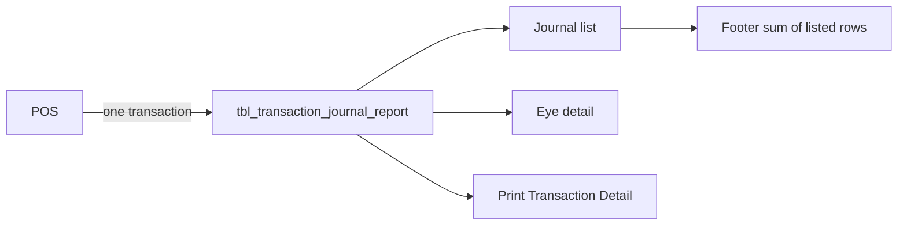

# Transaction Journal report table

One row per POS transaction. The list, the eye detail, and Print Transaction Detail all read that row. Checkout tables stay as they are. This report does not read `tbl_checkout_transaction`.

The list footer (Qty through Total) is not stored. The screen adds the rows that match the date and Transaction# search, the same way it does now in [`sumRetailJournalRows`](<src/app/(dashboard)/report/transaction-journal/_components/retail-transaction-journal-data.ts>).

## Columns

`tbl_transaction_journal_report` in [`database/reporting/retail/001-tables.sql`](database/reporting/retail/001-tables.sql), for newly provisioned retail stores only. An existing store schema gets this table manually, the same way as `tbl_shift_end_report` and `tbl_day_end_report`.

- `id` bigserial primary key. Eye URL `/report/transaction-journal/view/{id}`.
- `transactionid` bigint not null unique. POS transaction id. A later sync of the same transaction updates this row. Same role as `shiftid` and `batchid`.
- `transaction_date_time` timestamptz(6) not null. List Date/Time, and the date filter. The screen formats the label. Filter is the store-local date of this timestamp, from the picked start date through the picked end date. This is one timestamp, so there is no start/end overlap.
- `stationname` varchar(100) not null. List StationID and the detail Terminal Name.
- `transaction_number` varchar(50) not null. List Transaction#. The search box matches this text. It is not the upsert key, because the sample value is a code such as `ACFG866202`.
- `qty` varchar(40) not null. List Qty, stored as POS sends it.
- `discount` varchar(40) not null.
- `sub_total` varchar(40) not null.
- `tax` varchar(40) not null.
- `deposit` varchar(40) not null.
- `total` varchar(40) not null.
- `paid_by` varchar(50) null. The short list cell (`Cash`, `Card`, or blank).
- `cashier` varchar(100) null.
- `lines` jsonb not null default `'{"rows":[],"total":null}'`. Product table on the eye page and on Print Transaction Detail.
- `credit_card` jsonb not null default `'[]'`. Credit Card Detail card.
- `paid_by_amounts` jsonb not null default `'[]'`. Paid By card. This is separate from the short `paid_by` list cell.
- `created_at` timestamptz(6) not null default `now()`.

Index on `transaction_date_time`.

Header labels on the eye page that say Terminal `All`, Transaction `All Transaction`, Employee Name, and Selected Employee come from the filter and the signed-in session. They are not columns.

## JSON shapes

`lines.rows`: `quantity`, `itemNo`, `productName`, `retail`, `discount`, `amount`, `tax`, `deposit`, `total`.

`lines.total`: `retail`, `discount`, `amount`, `tax`, `deposit`, `total`. Print Transaction Detail uses every field, including `retail`, as the Subtotal row. The eye page prints Discount, Amount, Tax, Deposit, and Total, and leaves Retail blank.

`credit_card` is an ordered `{ "label", "value" }` list: Auth Code, Card, Reference, Date Time, Amount, Transaction Type. An empty value still keeps the label.

`paid_by_amounts` is the same `{ "label", "value" }` list: Cash, Check, Card, GiftCard, StoreCreditCard, FoodStamp, EBT, Voucher, Account, Papodw2. A new tender is another line, with no new column.

Money stays an exact decimal string. The screen does not rebuild line totals from the product rows.

API, Postman, and the live screens stay out of this step. After this structure is approved, the next step is the ingest route and replacing the fixture reads.
