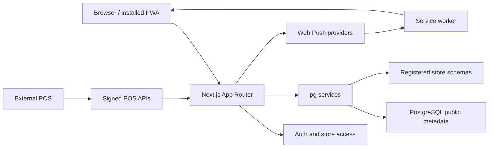

# Architecture

## Runtime boundaries

This is one Next.js application, with React pages and Web Request/Response route handlers. There is no separate Express service, controller framework, queue worker, or middleware/proxy file in the source inventory. Sensitive APIs authorize independently; the dashboard layout does not protect route handlers.



Deployment code targets OpenNext on Cloudflare Workers with `nodejs_compat`. `wrangler.jsonc` points to `.open-next/worker.js` and `.open-next/assets`, binds `HYPERDRIVE`, and enables observability. Store provisioning SQL from `database/reporting/*/001-tables.sql` is inlined into the Worker; the Worker filesystem does not contain those files. Neon is the database provider described in the deployment guide, not a special database SDK dependency. No deployment was performed for this handover.

## Frontend

`src/app/layout.tsx` supplies metadata, Inter font, theme, global CSS and Sonner. `providers.tsx` creates a QueryClient per mounted provider and wraps SessionProvider. `(dashboard)/layout.tsx` checks `auth()`, reads the selection cookie, obtains accessible stores, and renders `DashboardLayout`. The route group adds no URL prefix. `DashboardLayout` provides responsive sidebar/header/mobile navigation and `StoreProvider`.

Store switches call `/api/store-selection`, update context, invalidate queries, and refresh server rendering. The provider is keyed by initial selection and available codes. Reporting queries include store and filters in cache keys; live report subtrees remount on store changes. Fetch uses abort signals for reporting requests. Notifications poll every 30 seconds and invalidate when service-worker messages arrive. The inbox UI currently requests only the first API page.

Page-specific `_components` are colocated with report routes. Shared controls are in `src/components/tailgrids/core/`; these wrap accessible component libraries and class-variance-authority styles. CSS semantic tokens are centralized in `globals.css`, `css/default.css`, and `css/dark.css`.

## Backend and database

Handlers in `src/app/api/**/route.ts` delegate to `src/lib/`. Validation is hand-written TypeScript, not a schema validation library. `withDb` creates/connects a `pg.Client`, applies 5-second connection and 10-second statement timeouts, executes the callback, and closes the connection. Services own explicit transactions.

`getDatabaseConnectionString` prefers the Hyperdrive binding, falling back to `DATABASE_URL` outside Workers. Prisma is a separate generated client path: `withPrisma` creates a PrismaPg adapter/client per callback and disconnects it. Contrary to the older README, it is not a global singleton. `model-access.ts` dynamically resolves delegates; current live reporting uses raw SQL, and no generic model endpoint exposes it.

Public metadata tracks users, store access, credentials, notifications and schema mappings. Each store's reporting data lives in a registered `store_*` schema with a store-specific membership check. Customer schemas are legacy compatibility data. Never construct schema names from request input: resolve the registry on the server and validate identifiers with `schemaIdentifier`.

## Transaction guarantees and decisions encoded in source

```mermaid
sequenceDiagram
  participant POS
  participant API as POS orders API
  participant DB as PostgreSQL
  POS->>API: HMAC headers + full snapshot
  API->>DB: Active credential and schema lookup
  API->>API: Signature and payload validation
  API->>DB: BEGIN; recheck scope; advisory locks
  API->>DB: Receipt and source revision comparison
  API->>DB: Upsert parent and children; delete omitted children
  API->>DB: Record receipt; COMMIT
  API-->>POS: accepted / duplicate / stale
```

Snapshots use natural source codes for identity and server-generated report IDs internally. Exact decimal strings and bigint strings preserve transport precision. Separate aggregates avoid multiplying totals across joined items/payments; card attempts are never added as tender revenue. Read endpoints resolve permission and schema in the same repeatable-read read-only transaction as report reads.

Notifications commit durable inbox state before attempting push. Push is synchronous after commit, in batches of ten, without a retry outbox. Cleanup occurs during new event ingestion, not a scheduled worker. These are observed design choices; no architecture decision record explaining their original rationale exists.
