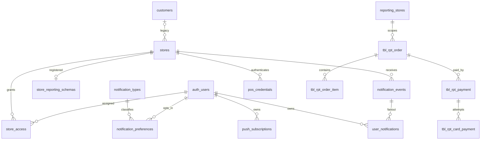

# Database schema and ownership

## Two schema sources

`prisma/schema.prisma` describes current **public metadata**; datasource PostgreSQL, generated client at `src/generated/prisma`, URL supplied by `prisma.config.ts`. SQL migrations/functions and `database/reporting/001-tables.sql` describe **per-store reporting**; those report tables are not Prisma models. Raw `pg` services are the active application data-access path. Prisma helper/client usage is server-only.

**Current desired Prisma shape is not the same as the migration-created public shape.** Initial and notification migrations use UUID IDs/natural keys; current Prisma uses integer auto-increment surrogate IDs. No ID-conversion migration exists. The field catalog below documents source, not a queried live database. See K1 in [KNOWN_ISSUES.md](KNOWN_ISSUES.md).

## Ownership and relations



Diagram edges summarize ownership; exact FK actions, composite keys and fields are cataloged below. Public Store is globally identified by unique immutable `store_code`; integer `id` is internal to current Prisma. Legacy customer_id is optional and retained. There is no current customer-login membership or customer-scoped authorization model.

`store_reporting_schemas` maps each store to unique schema name and version. New naming is `store_` plus lowercased store code with non `[a-z0-9_]` characters replaced by `_`; suffix 1–57. Existing hash-based mappings are preserved. The provisioning function returns an existing version-1 mapping without renaming it. Only trusted backend/provisioning roles should execute schema DDL; function is invoker-security with controlled search_path and revoked PUBLIC execution.

Each reporting schema has `reporting_stores` with one store_code constrained to that store and FK to public stores. Order/item/payment/card rows reference membership and natural parent codes. Source POS IDs are nullable bigint attributes, not the report primary keys. Report IDs are server-generated bigserial. Decimal money/quantity uses numeric(18,2); timestamp fields use timestamptz(6); business_date is a POS-supplied date.

## Keys, constraints and indexes

Public Prisma models below include their exact `@id`, `@unique`, `@@unique`, indexes, defaults, field mappings and relation actions. Important unique business keys are normalized user email, user/store access, preference user/store/type, event store/eventId, notification user/event, subscription endpoint, credential store/keyId, store code and schema name. Cascade deletes cover user-owned records; event store, notification type and schema store references restrict deletion. The SQL history also creates lowercase-email and canonical-store checks that Prisma syntax does not represent.

Reporting orders have UNIQUE(store_code,order_code). Items/payments/cards respectively have UNIQUE(store_code,order_item_code/payment_code/card_payment_code). Payments also have UNIQUE(store_code,order_code,payment_code); cards use that triple FK, preventing linkage to a payment in another order. Child/order FKs use DELETE RESTRICT; reconciliation removes dependants explicitly. Order source_revision has CHECK >0. sync_requests has primary key `(store_code,request_id)`, result CHECK accepted/duplicate/stale, and received_at; it is not a foreign-key child of orders.

Indexes: each report table `(store_code,business_date)`; children also `(store_code,order_code)`; sync requests `(store_code,received_at DESC)`. Current transaction filters read created_at and there is no corresponding explicit created_at index in the reporting DDL; assess scale before adding indexes.

## Migration history and operations

| Migration | Effect |
| --- | --- |
| `20260922000000_init` | UUID auth_users and email-keyed throttle, lowercase-email check |
| `20260929000000_store_notifications` | Role enum, stores/sample stores, access/preferences/events/inbox/push/POS credentials; UUID/natural-key public design |
| `20261009000000_customer_reporting` | Customers, optional store customer ownership, membership trigger for legacy customer schemas |
| `20261012000000_store_reporting` | Drops legacy membership trigger, adds store registry and provisioning, copies compatible legacy store data non-destructively; hash-based naming |
| `20261013000000_store_code_schema_names` | Wider schema-name constraint and code-based naming for new stores; existing mappings unchanged |

Provisioning creates six reporting tables, optionally copies matching legacy customer's four report tables and receipts for the selected store, preserves report IDs/revisions/timestamps, resets serial sequences, then registers version 1. `database/reporting/legacy-customer-001.sql` is the older customer DDL template; new writes do not use that scope. Installer reuses tracked SQL with idempotent registry/function creation and applies naming SQL. Public import reads existing four `public.tbl_rpt_*` tables consistently, validates complete snapshots, converts naive timestamps in store timezone and syncs with revision 1. It leaves source data intact and can conflict with previously imported changed content.

Do not infer production structure from migrations or Prisma alone. Inspect actual column types, constraints, mapping/version rows, migration ledger and privileges during an explicitly authorized database task. This handover made no database changes.

## Field catalogs

The following catalogs are generated directly from the current Prisma source, reporting payload metadata and latest provisioning SQL. Relation pseudo-fields are shown in Prisma declarations for completeness; they are not physical columns. Payload catalog documents accepted source fields; separate SQL catalog includes server-managed IDs/timestamps/hash/revision and receipt/membership fields.

### Prisma AuthRole

```prisma
ADMIN
  USER
```

### Prisma AuthUser

```prisma
id           Int      @id @default(autoincrement())
  name         String   @db.VarChar(120)
  email        String   @unique @db.VarChar(254)
  passwordHash String   @map("password_hash")
  role         AuthRole @default(USER)
  active       Boolean  @default(true)
  createdAt    DateTime @default(now()) @map("created_at") @db.Timestamptz(6)

  storeAccess             StoreAccess[]
  notificationPreferences NotificationPreference[]
  notifications           UserNotification[]
  pushSubscriptions       PushSubscription[]

  @@map("auth_users")
```

### Prisma AuthLoginAttempt

```prisma
id          Int      @id @default(autoincrement())
  email       String   @unique @db.VarChar(254)
  attempts    Int      @default(0)
  windowStart DateTime @default(now()) @map("window_start") @db.Timestamptz(6)

  @@map("auth_login_attempts")
```

### Prisma LegacyReportingCustomer

```prisma
id               Int      @id @default(autoincrement())
  name             String   @db.VarChar(160)
  schemaName       String   @unique @map("schema_name") @db.VarChar(63)
  active           Boolean  @default(true)
  reportingVersion Int      @default(0) @map("reporting_version")
  createdAt        DateTime @default(now()) @map("created_at") @db.Timestamptz(6)
  stores           Store[]

  @@map("customers")
```

### Prisma StoreReportingSchema

```prisma
storeCode String @id @map("store_code") @db.VarChar(64)
  schemaName String @unique @map("schema_name") @db.VarChar(63)
  reportingVersion Int @default(0) @map("reporting_version")
  createdAt DateTime @default(now()) @map("created_at") @db.Timestamptz(6)
  store Store @relation(fields: [storeCode], references: [storeCode], onDelete: Restrict, onUpdate: Restrict)

  @@map("store_reporting_schemas")
```

### Prisma Store

```prisma
id        Int      @id @default(autoincrement()) @map("id")
  storeCode String   @unique @map("store_code") @db.VarChar(64)
  name      String   @db.VarChar(160)
  timezone  String   @default("UTC") @db.VarChar(80)
  active    Boolean  @default(true)
  createdAt DateTime @default(now()) @map("created_at") @db.Timestamptz(6)
  updatedAt DateTime @updatedAt @map("updated_at") @db.Timestamptz(6)

  legacyCustomerId Int? @map("customer_id")
  legacyCustomer LegacyReportingCustomer? @relation(fields: [legacyCustomerId], references: [id], onDelete: Restrict)
  reportingSchema StoreReportingSchema?

  access                  StoreAccess[]
  notificationPreferences NotificationPreference[]
  notificationEvents      NotificationEvent[]
  notifications           UserNotification[]
  posCredentials          PosCredential[]

  @@unique([legacyCustomerId, storeCode], map: "stores_customer_code_unique")
  @@index([legacyCustomerId], map: "stores_customer_id_idx")
  @@map("stores")
```

### Prisma StoreAccess

```prisma
id        Int      @id @default(autoincrement())
  userId    Int      @map("user_id")
  storeCode String   @map("store_code") @db.VarChar(64)
  createdAt DateTime @default(now()) @map("created_at") @db.Timestamptz(6)

  user  AuthUser @relation(fields: [userId], references: [id], onDelete: Cascade)
  store Store    @relation(fields: [storeCode], references: [storeCode], onDelete: Cascade, onUpdate: Restrict)

  @@unique([userId, storeCode])
  @@index([storeCode])
  @@map("store_access")
```

### Prisma NotificationType

```prisma
id        Int      @id @default(autoincrement())
  key       String   @unique @db.VarChar(40)
  label     String   @db.VarChar(100)
  active    Boolean  @default(true)
  createdAt DateTime @default(now()) @map("created_at") @db.Timestamptz(6)

  preferences NotificationPreference[]
  events      NotificationEvent[]

  @@map("notification_types")
```

### Prisma NotificationPreference

```prisma
id        Int      @id @default(autoincrement())
  userId    Int      @map("user_id")
  storeCode String   @map("store_code") @db.VarChar(64)
  type      String   @map("notification_type") @db.VarChar(40)
  enabled   Boolean  @default(false)
  updatedAt DateTime @updatedAt @map("updated_at") @db.Timestamptz(6)

  user             AuthUser         @relation(fields: [userId], references: [id], onDelete: Cascade)
  store            Store            @relation(fields: [storeCode], references: [storeCode], onDelete: Cascade, onUpdate: Restrict)
  notificationType NotificationType @relation(fields: [type], references: [key], onDelete: Restrict, onUpdate: Restrict)

  @@unique([userId, storeCode, type])
  @@index([storeCode, type, enabled])
  @@map("notification_preferences")
```

### Prisma NotificationEvent

```prisma
id         Int      @id @default(autoincrement())
  eventId    String   @map("event_id") @db.VarChar(160)
  storeCode  String   @map("store_code") @db.VarChar(64)
  type       String   @map("notification_type") @db.VarChar(40)
  occurredAt DateTime @map("occurred_at") @db.Timestamptz(6)
  payload    Json
  title      String   @db.VarChar(180)
  body       String   @db.VarChar(500)
  targetPath String   @map("target_path") @db.VarChar(500)
  createdAt  DateTime @default(now()) @map("created_at") @db.Timestamptz(6)

  store            Store              @relation(fields: [storeCode], references: [storeCode], onDelete: Restrict, onUpdate: Restrict)
  notificationType NotificationType   @relation(fields: [type], references: [key], onDelete: Restrict, onUpdate: Restrict)
  notifications    UserNotification[]

  @@unique([storeCode, eventId])
  @@index([storeCode, createdAt(sort: Desc)])
  @@map("notification_events")
```

### Prisma UserNotification

```prisma
id                  Int       @id @default(autoincrement())
  userId              Int       @map("user_id")
  notificationEventId Int       @map("notification_event_id")
  storeCode           String    @map("store_code") @db.VarChar(64)
  readAt              DateTime? @map("read_at") @db.Timestamptz(6)
  createdAt           DateTime  @default(now()) @map("created_at") @db.Timestamptz(6)

  user  AuthUser          @relation(fields: [userId], references: [id], onDelete: Cascade)
  event NotificationEvent @relation(fields: [notificationEventId], references: [id], onDelete: Cascade)
  store Store             @relation(fields: [storeCode], references: [storeCode], onDelete: Cascade, onUpdate: Restrict)

  @@unique([userId, notificationEventId])
  @@index([userId, storeCode, createdAt(sort: Desc)])
  @@map("user_notifications")
```

### Prisma PushSubscription

```prisma
id             Int       @id @default(autoincrement())
  userId         Int       @map("user_id")
  endpoint       String    @unique
  p256dh         String
  auth           String
  expirationTime DateTime? @map("expiration_time") @db.Timestamptz(6)
  userAgent      String?   @map("user_agent") @db.VarChar(500)
  failureCount   Int       @default(0) @map("failure_count")
  lastSeenAt     DateTime  @default(now()) @map("last_seen_at") @db.Timestamptz(6)
  createdAt      DateTime  @default(now()) @map("created_at") @db.Timestamptz(6)

  user AuthUser @relation(fields: [userId], references: [id], onDelete: Cascade)

  @@index([userId])
  @@map("push_subscriptions")
```

### Prisma PosCredential

```prisma
id              Int       @id @default(autoincrement())
  storeCode       String    @map("store_code") @db.VarChar(64)
  keyId           String    @map("key_id") @db.VarChar(80)
  encryptedSecret String    @map("encrypted_secret")
  iv              String    @db.VarChar(64)
  active          Boolean   @default(true)
  createdAt       DateTime  @default(now()) @map("created_at") @db.Timestamptz(6)
  rotatedAt       DateTime? @map("rotated_at") @db.Timestamptz(6)

  store Store @relation(fields: [storeCode], references: [storeCode], onDelete: Cascade, onUpdate: Restrict)

  @@unique([storeCode, keyId])
  @@map("pos_credentials")
```

### Payload fields: tbl_rpt_order

Natural record key: `order_code`. Database constraints/columns follow below.

| Column | Kind | Required in payload | Max length | Missing default |
| --- | --- | --- | --- | --- |
| `order_id` | bigint | false | ? | `null` |
| `order_code` | string | true | 50 | `required` |
| `order_number` | string | false | 100 | `null` |
| `checkid` | string | false | 20 | `null` |
| `store_code` | string | true | 64 | `required` |
| `station_code` | string | false | 50 | `null` |
| `shift_code` | string | false | 50 | `null` |
| `batch_code` | string | false | 50 | `null` |
| `order_type` | string | false | 50 | `null` |
| `order_status` | string | false | 50 | `null` |
| `customer_code` | string | false | 40 | `null` |
| `customer_name` | string | false | 200 | `null` |
| `subtotal` | decimal | false | ? | `"0.00"` |
| `tax` | decimal | false | ? | `"0.00"` |
| `discount` | decimal | false | ? | `"0.00"` |
| `fees` | decimal | false | ? | `"0.00"` |
| `surcharge` | decimal | false | ? | `"0.00"` |
| `tip_amount` | decimal | false | ? | `"0.00"` |
| `gratuity` | decimal | false | ? | `"0.00"` |
| `total` | decimal | false | ? | `"0.00"` |
| `paid_amount` | decimal | false | ? | `"0.00"` |
| `balance_amount` | decimal | false | ? | `"0.00"` |
| `payment_method` | string | false | 50 | `null` |
| `payment_status` | string | false | 50 | `null` |
| `is_void` | boolean | false | ? | `false` |
| `is_return` | boolean | false | ? | `false` |
| `is_tax_exempt` | boolean | false | ? | `false` |
| `is_split` | boolean | false | ? | `false` |
| `order_fees` | jsonb | false | ? | `{}` |
| `created_by` | bigint | false | ? | `null` |
| `created_by_code` | string | false | 30 | `null` |
| `business_date` | date | true | ? | `required` |
| `created_at` | timestamp | true | ? | `required` |
| `completed_at` | timestamp | false | ? | `null` |

### Payload fields: tbl_rpt_order_item

Natural record key: `order_item_code`. Database constraints/columns follow below.

| Column | Kind | Required in payload | Max length | Missing default |
| --- | --- | --- | --- | --- |
| `order_id` | bigint | false | ? | `null` |
| `order_code` | string | true | 50 | `required` |
| `order_number` | string | true | 100 | `required` |
| `order_item_id` | bigint | false | ? | `null` |
| `order_item_code` | string | true | 50 | `required` |
| `business_date` | date | true | ? | `required` |
| `store_code` | string | true | 64 | `required` |
| `station_code` | string | false | 50 | `null` |
| `shift_code` | string | false | 50 | `null` |
| `batch_code` | string | false | 50 | `null` |
| `department_code` | string | false | 50 | `null` |
| `department_name` | string | false | 200 | `null` |
| `category_code` | string | false | 50 | `null` |
| `category_name` | string | false | 200 | `null` |
| `menu_item_code` | string | false | 100 | `null` |
| `item_name` | string | false | 500 | `null` |
| `quantity` | decimal | false | ? | `"0.00"` |
| `price` | decimal | false | ? | `"0.00"` |
| `subtotal` | decimal | false | ? | `"0.00"` |
| `tax_code` | string | false | 50 | `null` |
| `tax_name` | string | false | 50 | `null` |
| `tax_amt` | decimal | false | ? | `"0.00"` |
| `discount_amt` | decimal | false | ? | `"0.00"` |
| `gift_card_code` | string | false | 50 | `null` |
| `tran_discount_code` | string | false | 50 | `null` |
| `tran_discount_name` | string | false | 50 | `null` |
| `tran_discount` | decimal | false | ? | `"0.00"` |
| `tran_discount_tax` | decimal | false | ? | `"0.00"` |
| `item_discount_code` | string | false | 50 | `null` |
| `item_discount_name` | string | false | 50 | `null` |
| `item_discount` | decimal | false | ? | `"0.00"` |
| `item_discount_tax` | decimal | false | ? | `"0.00"` |
| `comno_header` | string | false | 100 | `null` |
| `combo_group_name` | string | false | 100 | `null` |
| `combo_discount` | decimal | false | ? | `"0.00"` |
| `combo_discount_tax` | decimal | false | ? | `"0.00"` |
| `discount_code` | string | false | 50 | `null` |
| `discount_type` | string | false | 50 | `null` |
| `discount_reason` | string | false | 255 | `null` |
| `discount_approved_by` | string | false | 50 | `null` |
| `cash_price` | decimal | false | ? | `"0.00"` |
| `card_price` | decimal | false | ? | `"0.00"` |
| `is_discounted_row` | boolean | false | ? | `false` |
| `is_void` | boolean | false | ? | `false` |
| `void_reason` | string | false | 500 | `null` |
| `is_return` | boolean | false | ? | `false` |
| `return_quantity` | decimal | false | ? | `"0.00"` |
| `created_at` | timestamp | false | ? | `null` |

### Payload fields: tbl_rpt_payment

Natural record key: `payment_code`. Database constraints/columns follow below.

| Column | Kind | Required in payload | Max length | Missing default |
| --- | --- | --- | --- | --- |
| `payment_id` | bigint | false | ? | `null` |
| `payment_code` | string | true | 50 | `required` |
| `order_code` | string | true | 50 | `required` |
| `split_code` | string | false | 50 | `null` |
| `business_date` | date | true | ? | `required` |
| `store_code` | string | true | 64 | `required` |
| `station_code` | string | false | 50 | `null` |
| `shift_code` | string | false | 50 | `null` |
| `batch_code` | string | false | 50 | `null` |
| `tender_code` | string | false | 50 | `null` |
| `tender_name` | string | false | 50 | `null` |
| `payment_amount` | decimal | false | ? | `"0.00"` |
| `round_off_amt` | decimal | false | ? | `"0.00"` |
| `tip_amount` | decimal | false | ? | `"0.00"` |
| `fees` | decimal | false | ? | `"0.00"` |
| `surcharge` | decimal | false | ? | `"0.00"` |
| `total_amount` | decimal | false | ? | `"0.00"` |
| `payable_amount` | decimal | false | ? | `"0.00"` |
| `change_amount` | decimal | false | ? | `"0.00"` |
| `payment_split_no` | integer | false | ? | `1` |
| `payment_status` | string | false | 50 | `null` |
| `gift_card_no` | string | false | 50 | `null` |
| `card_type` | string | false | 50 | `null` |
| `issuer` | string | false | 150 | `null` |
| `mask_pan` | string | false | 150 | `null` |
| `tran_type` | string | false | 50 | `null` |
| `entry_mode` | string | false | 50 | `null` |
| `is_void` | boolean | false | ? | `false` |
| `is_capture` | boolean | false | ? | `false` |
| `split_json` | jsonb | false | ? | `{}` |
| `created_on` | timestamp | false | ? | `null` |

### Payload fields: tbl_rpt_card_payment

Natural record key: `card_payment_code`. Database constraints/columns follow below.

| Column | Kind | Required in payload | Max length | Missing default |
| --- | --- | --- | --- | --- |
| `card_payment_id` | bigint | false | ? | `null` |
| `card_payment_code` | string | true | 50 | `required` |
| `payment_code` | string | true | 50 | `required` |
| `order_code` | string | true | 50 | `required` |
| `split_code` | string | false | 50 | `null` |
| `business_date` | date | true | ? | `required` |
| `store_code` | string | true | 64 | `required` |
| `station_code` | string | false | 50 | `null` |
| `shift_code` | string | false | 50 | `null` |
| `batch_code` | string | false | 50 | `null` |
| `device_type` | string | false | 50 | `null` |
| `device_serial_no` | string | false | 100 | `null` |
| `mid` | string | false | 50 | `null` |
| `tid` | string | false | 50 | `null` |
| `tran_id` | string | false | 100 | `null` |
| `rrn` | string | false | 150 | `null` |
| `stan_id` | string | false | 50 | `null` |
| `auth_code` | string | false | 50 | `null` |
| `tran_type` | string | false | 50 | `null` |
| `entry_mode` | string | false | 50 | `null` |
| `card_type` | string | false | 50 | `null` |
| `issuer` | string | false | 150 | `null` |
| `mask_pan` | string | false | 150 | `null` |
| `sale_amount` | decimal | false | ? | `"0.00"` |
| `tip_amount` | decimal | false | ? | `"0.00"` |
| `surcharge_amount` | decimal | false | ? | `"0.00"` |
| `total_amount` | decimal | false | ? | `"0.00"` |
| `response_code` | string | false | 20 | `null` |
| `is_void` | boolean | false | ? | `false` |
| `is_capture` | boolean | false | ? | `false` |
| `created_on` | timestamp | false | ? | `null` |
| `response_text` | string | false | 10000 | `null` |

### Physical reporting DDL

Extracted from the current provisioning function. `__SCHEMA__` and `__STORE_CODE__` are replaced server-side with quoted identifiers/literals. Includes every column, default, FK and index; this is a reference, not an instruction to execute placeholder SQL.

```sql
CREATE TABLE __SCHEMA__.reporting_stores (
    store_code varchar(64) PRIMARY KEY CHECK (store_code = __STORE_CODE__),
    FOREIGN KEY (store_code) REFERENCES public.stores(store_code) ON UPDATE RESTRICT ON DELETE RESTRICT
);

CREATE TABLE __SCHEMA__.tbl_rpt_order (
    report_id bigserial PRIMARY KEY,
    order_id bigint,
    order_code varchar(50) NOT NULL,
    order_number varchar(100),
    checkid varchar(20),
    store_code varchar(64) NOT NULL,
    station_code varchar(50),
    shift_code varchar(50),
    batch_code varchar(50),
    order_type varchar(50),
    order_status varchar(50),
    customer_code varchar(40),
    customer_name varchar(200),
    subtotal numeric(18,2) NOT NULL DEFAULT 0,
    tax numeric(18,2) NOT NULL DEFAULT 0,
    discount numeric(18,2) NOT NULL DEFAULT 0,
    fees numeric(18,2) NOT NULL DEFAULT 0,
    surcharge numeric(18,2) NOT NULL DEFAULT 0,
    tip_amount numeric(18,2) NOT NULL DEFAULT 0,
    gratuity numeric(18,2) NOT NULL DEFAULT 0,
    total numeric(18,2) NOT NULL DEFAULT 0,
    paid_amount numeric(18,2) NOT NULL DEFAULT 0,
    balance_amount numeric(18,2) NOT NULL DEFAULT 0,
    payment_method varchar(50),
    payment_status varchar(50),
    is_void boolean NOT NULL DEFAULT false,
    is_return boolean NOT NULL DEFAULT false,
    is_tax_exempt boolean NOT NULL DEFAULT false,
    is_split boolean NOT NULL DEFAULT false,
    order_fees jsonb NOT NULL DEFAULT '{}'::jsonb,
    created_by bigint,
    created_by_code varchar(30),
    business_date date NOT NULL,
    created_at timestamptz(6) NOT NULL,
    completed_at timestamptz(6),
    rpt_created_on timestamptz(6) NOT NULL DEFAULT now(),
    rpt_updated_on timestamptz(6) NOT NULL DEFAULT now(),
    source_revision bigint NOT NULL CHECK (source_revision > 0),
    snapshot_hash varchar(64) NOT NULL,
    UNIQUE (store_code, order_code),
    FOREIGN KEY (store_code) REFERENCES __SCHEMA__.reporting_stores(store_code) ON DELETE RESTRICT
);
CREATE INDEX ON __SCHEMA__.tbl_rpt_order(store_code, business_date);

CREATE TABLE __SCHEMA__.tbl_rpt_order_item (
    report_item_id bigserial PRIMARY KEY,
    order_id bigint,
    order_code varchar(50) NOT NULL,
    order_number varchar(100) NOT NULL,
    order_item_id bigint,
    order_item_code varchar(50) NOT NULL,
    business_date date NOT NULL,
    store_code varchar(64) NOT NULL,
    station_code varchar(50),
    shift_code varchar(50),
    batch_code varchar(50),
    department_code varchar(50),
    department_name varchar(200),
    category_code varchar(50),
    category_name varchar(200),
    menu_item_code varchar(100),
    item_name varchar(500),
    quantity numeric(18,2) NOT NULL DEFAULT 0,
    price numeric(18,2) NOT NULL DEFAULT 0,
    subtotal numeric(18,2) NOT NULL DEFAULT 0,
    tax_code varchar(50),
    tax_name varchar(50),
    tax_amt numeric(18,2) NOT NULL DEFAULT 0,
    discount_amt numeric(18,2) NOT NULL DEFAULT 0,
    gift_card_code varchar(50),
    tran_discount_code varchar(50),
    tran_discount_name varchar(50),
    tran_discount numeric(18,2) NOT NULL DEFAULT 0,
    tran_discount_tax numeric(18,2) NOT NULL DEFAULT 0,
    item_discount_code varchar(50),
    item_discount_name varchar(50),
    item_discount numeric(18,2) NOT NULL DEFAULT 0,
    item_discount_tax numeric(18,2) NOT NULL DEFAULT 0,
    comno_header varchar(100),
    combo_group_name varchar(100),
    combo_discount numeric(18,2) NOT NULL DEFAULT 0,
    combo_discount_tax numeric(18,2) NOT NULL DEFAULT 0,
    discount_code varchar(50),
    discount_type varchar(50),
    discount_reason varchar(255),
    discount_approved_by varchar(50),
    cash_price numeric(18,2) NOT NULL DEFAULT 0,
    card_price numeric(18,2) NOT NULL DEFAULT 0,
    is_discounted_row boolean NOT NULL DEFAULT false,
    is_void boolean NOT NULL DEFAULT false,
    void_reason varchar(500),
    is_return boolean NOT NULL DEFAULT false,
    return_quantity numeric(18,2) NOT NULL DEFAULT 0,
    created_at timestamptz(6),
    rpt_created_on timestamptz(6) NOT NULL DEFAULT now(),
    rpt_updated_on timestamptz(6) NOT NULL DEFAULT now(),
    UNIQUE (store_code, order_item_code),
    FOREIGN KEY (store_code) REFERENCES __SCHEMA__.reporting_stores(store_code) ON DELETE RESTRICT,
    FOREIGN KEY (store_code, order_code) REFERENCES __SCHEMA__.tbl_rpt_order(store_code, order_code) ON DELETE RESTRICT
);
CREATE INDEX ON __SCHEMA__.tbl_rpt_order_item(store_code, business_date);
CREATE INDEX ON __SCHEMA__.tbl_rpt_order_item(store_code, order_code);

CREATE TABLE __SCHEMA__.tbl_rpt_payment (
    report_payment_id bigserial PRIMARY KEY,
    payment_id bigint,
    payment_code varchar(50) NOT NULL,
    order_code varchar(50) NOT NULL,
    split_code varchar(50),
    business_date date NOT NULL,
    store_code varchar(64) NOT NULL,
    station_code varchar(50),
    shift_code varchar(50),
    batch_code varchar(50),
    tender_code varchar(50),
    tender_name varchar(50),
    payment_amount numeric(18,2) NOT NULL DEFAULT 0,
    round_off_amt numeric(18,2) NOT NULL DEFAULT 0,
    tip_amount numeric(18,2) NOT NULL DEFAULT 0,
    fees numeric(18,2) NOT NULL DEFAULT 0,
    surcharge numeric(18,2) NOT NULL DEFAULT 0,
    total_amount numeric(18,2) NOT NULL DEFAULT 0,
    payable_amount numeric(18,2) NOT NULL DEFAULT 0,
    change_amount numeric(18,2) NOT NULL DEFAULT 0,
    payment_split_no integer DEFAULT 1,
    payment_status varchar(50),
    gift_card_no varchar(50),
    card_type varchar(50),
    issuer varchar(150),
    mask_pan varchar(150),
    tran_type varchar(50),
    entry_mode varchar(50),
    is_void boolean NOT NULL DEFAULT false,
    is_capture boolean NOT NULL DEFAULT false,
    split_json jsonb NOT NULL DEFAULT '{}'::jsonb,
    created_on timestamptz(6),
    rpt_created_on timestamptz(6) NOT NULL DEFAULT now(),
    rpt_updated_on timestamptz(6) NOT NULL DEFAULT now(),
    UNIQUE (store_code, payment_code),
    FOREIGN KEY (store_code) REFERENCES __SCHEMA__.reporting_stores(store_code) ON DELETE RESTRICT,
    FOREIGN KEY (store_code, order_code) REFERENCES __SCHEMA__.tbl_rpt_order(store_code, order_code) ON DELETE RESTRICT,
    UNIQUE (store_code, order_code, payment_code)
);
CREATE INDEX ON __SCHEMA__.tbl_rpt_payment(store_code, business_date);
CREATE INDEX ON __SCHEMA__.tbl_rpt_payment(store_code, order_code);

CREATE TABLE __SCHEMA__.tbl_rpt_card_payment (
    report_card_id bigserial PRIMARY KEY,
    card_payment_id bigint,
    card_payment_code varchar(50) NOT NULL,
    payment_code varchar(50) NOT NULL,
    order_code varchar(50) NOT NULL,
    split_code varchar(50),
    business_date date NOT NULL,
    store_code varchar(64) NOT NULL,
    station_code varchar(50),
    shift_code varchar(50),
    batch_code varchar(50),
    device_type varchar(50),
    device_serial_no varchar(100),
    mid varchar(50),
    tid varchar(50),
    tran_id varchar(100),
    rrn varchar(150),
    stan_id varchar(50),
    auth_code varchar(50),
    tran_type varchar(50),
    entry_mode varchar(50),
    card_type varchar(50),
    issuer varchar(150),
    mask_pan varchar(150),
    sale_amount numeric(18,2) NOT NULL DEFAULT 0,
    tip_amount numeric(18,2) NOT NULL DEFAULT 0,
    surcharge_amount numeric(18,2) NOT NULL DEFAULT 0,
    total_amount numeric(18,2) NOT NULL DEFAULT 0,
    response_code varchar(20),
    response_text text,
    is_void boolean NOT NULL DEFAULT false,
    is_capture boolean NOT NULL DEFAULT false,
    created_on timestamptz(6),
    rpt_created_on timestamptz(6) NOT NULL DEFAULT now(),
    rpt_updated_on timestamptz(6) NOT NULL DEFAULT now(),
    UNIQUE (store_code, card_payment_code),
    FOREIGN KEY (store_code) REFERENCES __SCHEMA__.reporting_stores(store_code) ON DELETE RESTRICT,
    FOREIGN KEY (store_code, order_code) REFERENCES __SCHEMA__.tbl_rpt_order(store_code, order_code) ON DELETE RESTRICT,
    FOREIGN KEY (store_code, order_code, payment_code) REFERENCES __SCHEMA__.tbl_rpt_payment(store_code, order_code, payment_code) ON DELETE RESTRICT
);
CREATE INDEX ON __SCHEMA__.tbl_rpt_card_payment(store_code, business_date);
CREATE INDEX ON __SCHEMA__.tbl_rpt_card_payment(store_code, order_code);

CREATE TABLE __SCHEMA__.sync_requests (
    store_code varchar(64) NOT NULL REFERENCES __SCHEMA__.reporting_stores(store_code),
    request_id varchar(160) NOT NULL,
    order_code varchar(50) NOT NULL,
    source_revision bigint NOT NULL,
    snapshot_hash varchar(64) NOT NULL,
    result varchar(20) NOT NULL CHECK (result IN ('accepted', 'duplicate', 'stale')),
    received_at timestamptz(6) NOT NULL DEFAULT now(),
    PRIMARY KEY (store_code, request_id)
);
CREATE INDEX ON __SCHEMA__.sync_requests(store_code, received_at DESC);
```
